# Rapidli: Rapid Local Inference

**A local AI chat that writes one answer with up to 248 lanes at once, on your own NVIDIA graphics card.**

Rapidli plans an answer first, then writes every part of it side by side in the same pass over the model. A long
article, a module of 32 functions or a page of 64 animations comes back several times faster than one stream of tokens
could write it, from the same model file you already have.

### Watch the 1-minute demo

https://github.com/user-attachments/assets/08ff6784-08fd-47d6-8cf0-544aa5170138

<sub>Real time unless marked as a time-lapse, one RTX 4090: long articles, a 62 GB model on a 24 GB card, 64 animations, 12 artworks and 12 games, each from one prompt.</sub>

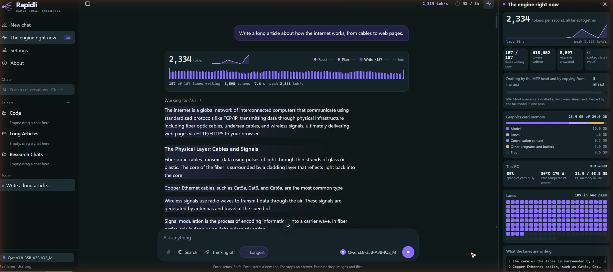
<sub>Real time, one RTX 4090. Qwen3.8-35B-A3B (15 GB) writes a 24,747-token article in 17.6 s: 158 lanes, an engine-measured peak of 2,353 tokens a second.</sub>

| **2,353 tok/s** | **5,024 tok/s** | **474 tok/s** |
|:---:|:---:|:---:|
| a 35B model, 158 lanes, one long article | a 2B model, peak second | a **62 GB** model on a **24 GB** card: the rest sits in system RAM |

Every figure on this page is Rapidli's own measurement. The engine times its own passes, and the live meter, the
figure under each answer and the Top 10 all show that same number. These are tokens per second for all lanes together
writing **one** answer. One lane alone writes about 45 to 220 tokens a second on the same card, depending on the model and on drafting.

---

## Contents

[How it differs](#how-it-differs) · [Who it is for](#who-it-is-for) · [Screenshots](#screenshots) ·
[What you need](#what-you-need) · [Install: Windows](#windows) · [Linux](#linux) · [macOS](#macos-help-wanted) ·
[First start](#first-start) · [Features](#features) · [API](#the-api) · [Tested on](#tested-on) · [Limits](#limits) ·
[Trouble](#trouble) · [Contributing](#contributing)

## How it differs

Most local chat apps write an answer one token after another. Their "parallel" settings serve several *separate*
requests at once, so a single long answer still comes out at the speed of a single stream. Rapidli works differently:

| | A typical local chat app | Rapidli |
|---|---|---|
| **One long answer** | one stream, one token per pass | planned once, then written by many lanes in the same pass (the weights are read once for all of them) |
| **How many lanes** | a number you set by hand | measured on load: it fits as many lanes as your card holds, checks nothing spilled into system memory, and fits again when other programs take or free graphics memory |
| **Models larger than the card** | a dense model gets layers moved to the processor (slow); a mixture-of-experts model gets its experts computed on the processor | a mixture-of-experts model keeps its most-used experts cached **on the card**; the rest sit in pinned system RAM and are copied over when needed |
| **Short answers** | one token per pass | drafted several tokens ahead (by the model's own MTP head, or by copying from the text) and checked in one pass |
| **The speed you see** | an estimate | timed by the engine itself, per second, shown live |
| **Your models** | its own model library | finds the GGUF files you already downloaded with LM Studio, Ollama, Jan, GPT4All, llama.cpp or the Hugging Face cache |
| **Code it writes** | one file, written top to bottom | a page of 12 to 64 functions writes every function on its own lanes, checks each in a headless browser and keeps the version that works; the result runs beside the chat |

The engine is a small C++ server on top of [llama.cpp](https://github.com/ggml-org/llama.cpp) (Unsloth's fork) with
Rapidli's own patches to its CUDA kernels and memory. The app is plain Python (standard library only) and one web
page. Everything runs on your computer.

## Who it is for

- **People with a gaming or workstation NVIDIA card** who want long answers, articles, reports and stories in seconds,
  privately, without a subscription.
- **Developers** who want a fast local model behind an OpenAI-compatible API, or who generate code and pages in bulk.
- **Owners of a big mixture-of-experts model that doesn't fit their card**, but whose computer has enough RAM.
- **Anyone curious about parallel decoding**: the engine, its patches and every measurement are in this repository.

## Screenshots

### Speed

| | |
|---|---|
| 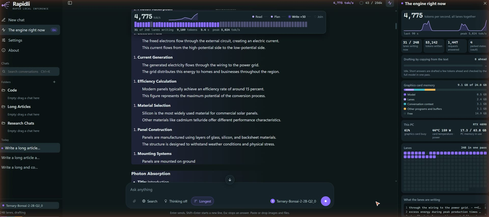 | 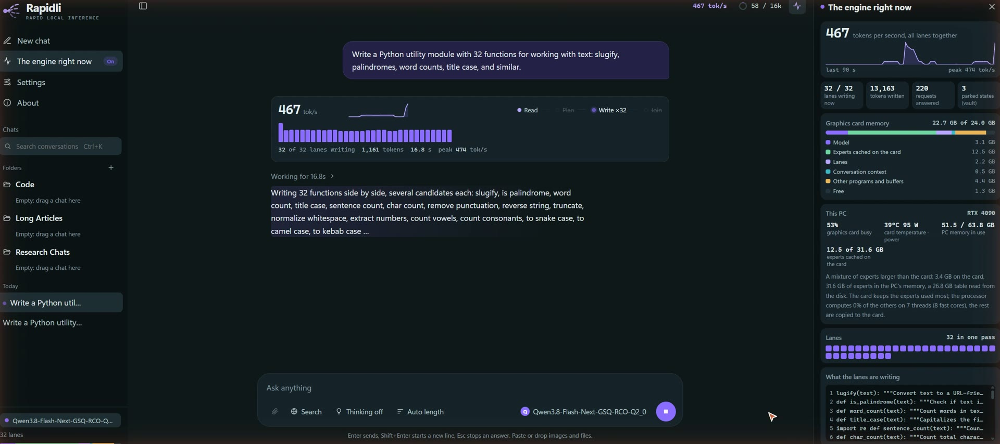 |
| **A small model:** Ternary-Bonsai-2-2B (0.5 GB). 248 lanes fit, and the best second reached **5,024 tok/s**. | **A model larger than the card:** Qwen3.8-Flash-Next (61.9 GB) on 24 GB of graphics memory and 64 GB of RAM. A 32-function Python module in 22.7 s, 32 of 32 pass the check, peak **474 tok/s**. |
| 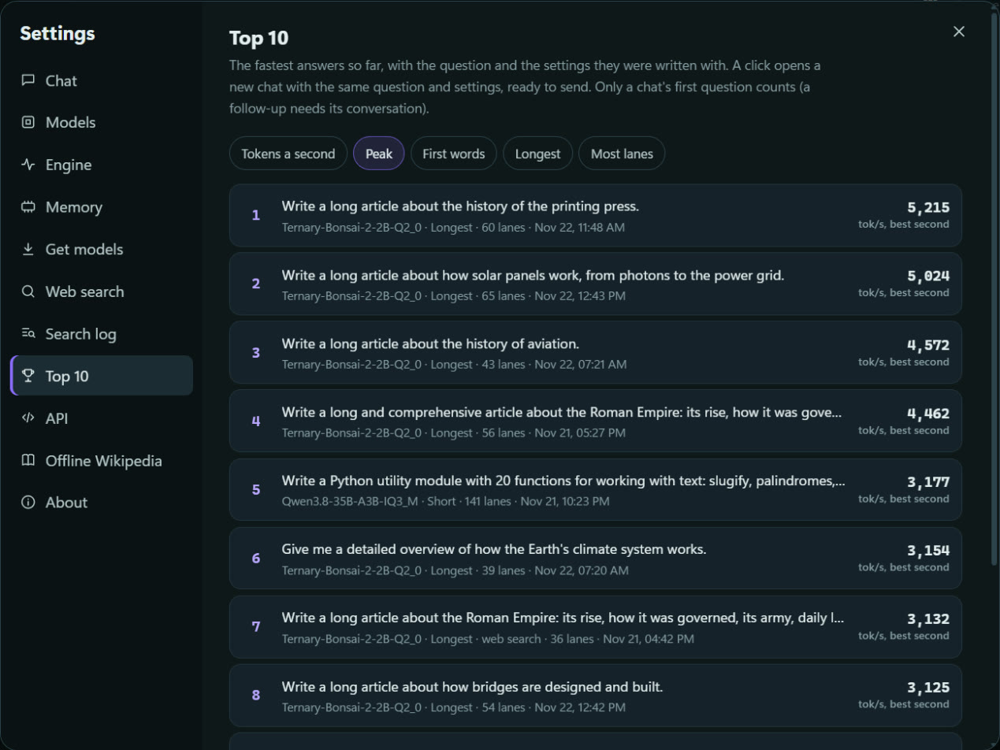 | 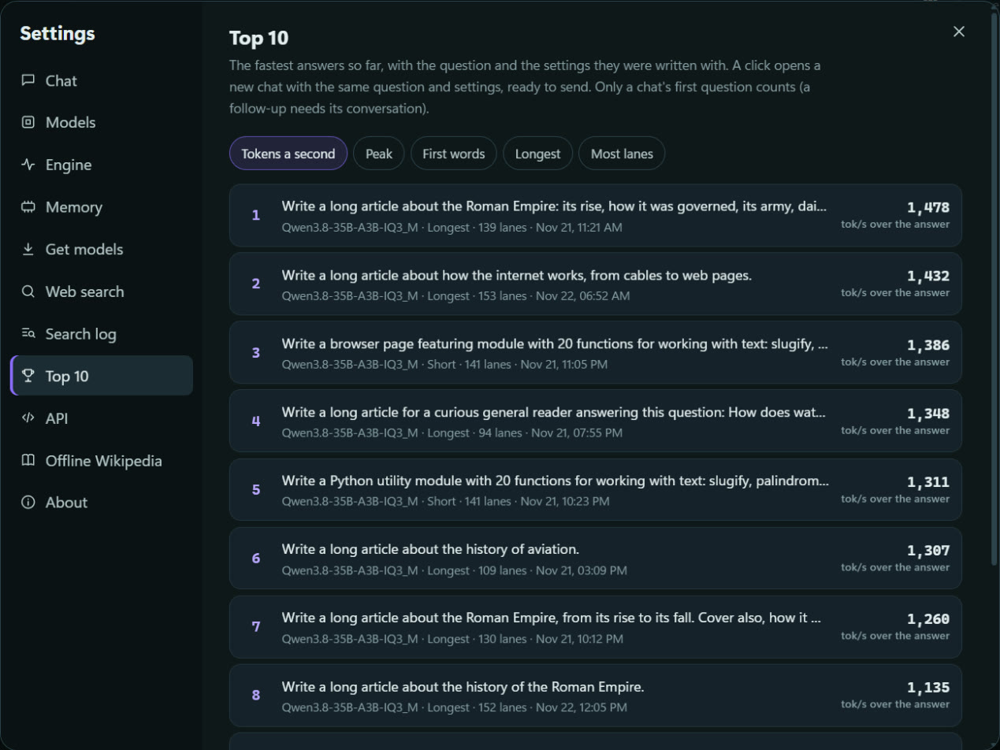 |
| **Settings › Top 10, best second.** It keeps the record answers with their question and settings; a click asks again. | **Top 10, over the whole answer.** Long articles of 14,000 to 23,000 tokens, averaged from the first token to the last. |

### What it makes

| | |
|---|---|
| 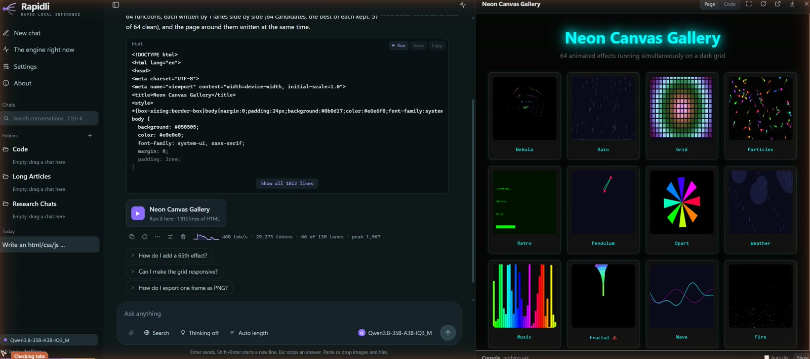 | 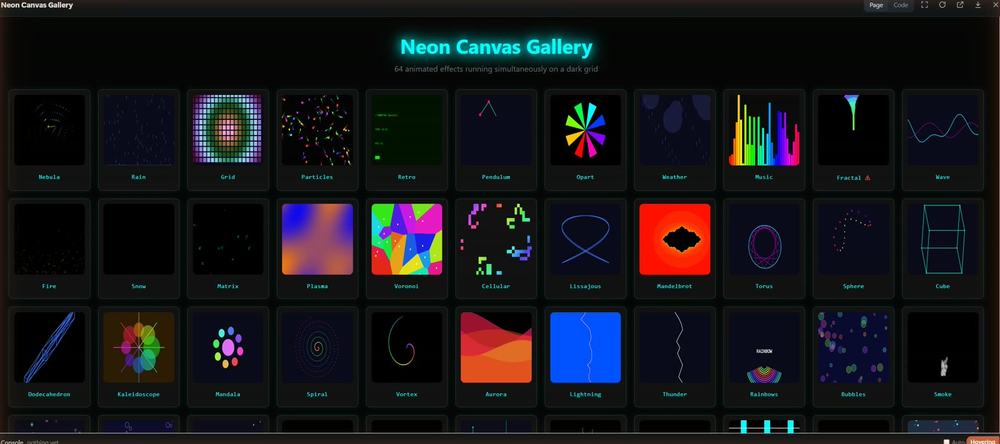 |
| **One prompt, 64 animated effects.** 1,813 lines of HTML in 64 s on 66 lanes, with every function checked. **Run** shows it beside the conversation, with its console and an "Ask to fix". | Full screen. 57 of the 64 effects passed the check; the rest are shown as they are. |
| 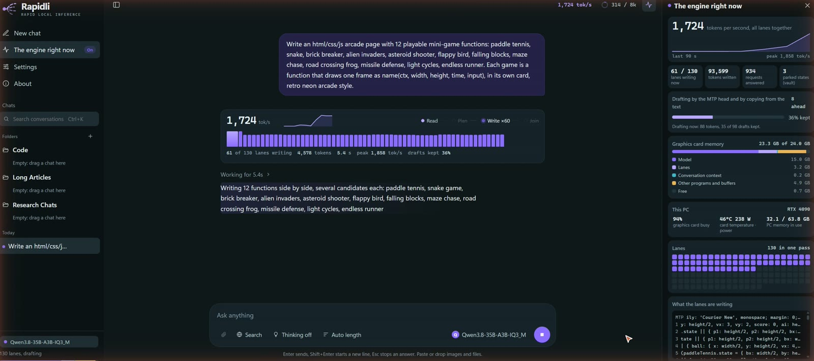 | 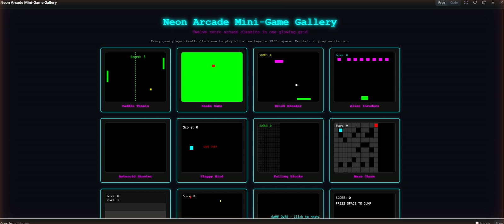 |
| **12 playable mini-games**, several candidates per game written side by side. The loom shows every lane. | The result: one HTML file, playable in the app. |
| 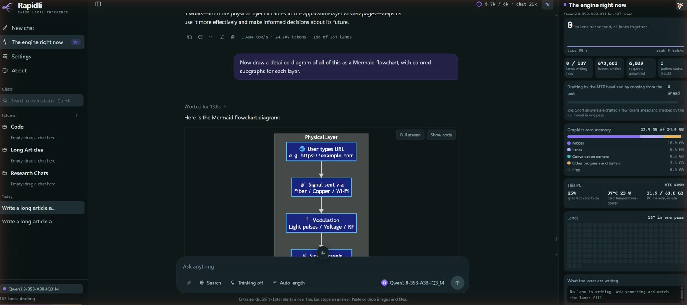 | 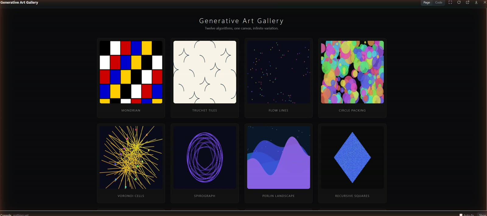 |
| **Diagrams:** Mermaid charts drawn in the answer; open them full screen to drag and zoom. | **A generative art gallery:** 12 algorithms written in 19 s. |
| 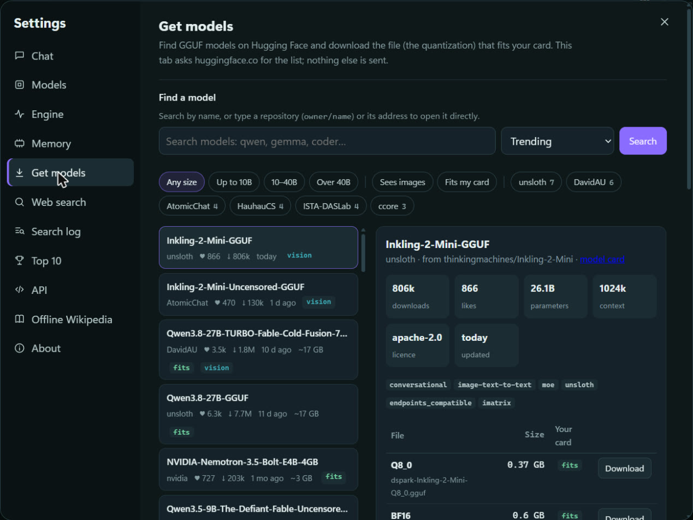 | 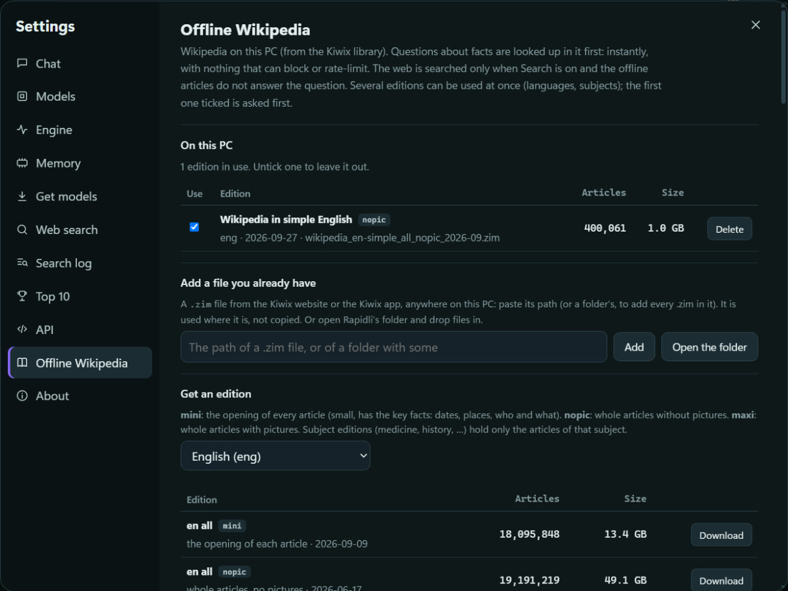 |
| **Get models:** search Hugging Face, see each file's size and whether it fits your card, and download over several connections. | **Offline Wikipedia:** 400,000 articles (1 GB) are offered on the first start and looked up before the web. |

## What you need

| | |
|---|---|
| **Graphics card** | **NVIDIA**, RTX 20 series or newer (Turing, compute capability 7.5+): RTX 20, 30, 40 and 50 series, and the matching workstation cards. The Windows release has native code for RTX 20, 30, 40 and 50; the Linux release for RTX 20, 30 and 40 (an RTX 50 on Linux needs a build with CUDA 12.8+). Only an RTX 4090 has been measured. AMD, Intel and Apple GPUs are **not supported yet** (the engine uses CUDA kernels of its own). |
| **Graphics memory** | Any amount. Rapidli measures what a lane costs and fits as many as your card holds, so a smaller card runs the same models with fewer lanes and lower totals. The model file should fit the card with room to spare, unless it is a mixture of experts (below). Get models marks which files fit yours. |
| **System memory (RAM)** | Enough for the app (a few GB). For a **mixture-of-experts model larger than the card**, the experts that don't fit stay in RAM, so you need free RAM of roughly the model size minus the part on the card: the 61.9 GB model above ran with 64 GB. A **dense** model larger than the card is not supported (it is refused with "does not fit"). |
| **Operating system** | Windows 11 (tested; Windows 10 should work) or Linux (64-bit; built and started under WSL 2 only, untested on a native install). macOS: [help wanted](#macos-help-wanted). |
| **Software** | The NVIDIA driver, the CUDA toolkit (13 on Windows; 12.x or 13 on Linux) and Python 3.10 or newer. |
| **Models** | Any GGUF chat model that llama.cpp (Unsloth's fork) loads. Measured families include Qwen3.6/3.8 (dense and mixture of experts, with MTP drafting), Ternary-Bonsai, and Gemma 4 / Nemotron. |

## Install

### Windows

1. Install the **NVIDIA driver** (a current one) and the **[CUDA Toolkit 13](https://developer.nvidia.com/cuda-downloads)**.
   Rapidli uses its cuBLAS libraries and finds them through `CUDA_PATH`, which the installer sets.
2. Install **[Python 3.10 or newer](https://www.python.org/downloads/)** (keep "py launcher" ticked).
3. Get Rapidli: `git clone https://github.com/JozefJarosciak/Rapidli.git`, or download the source ZIP from this page.
4. From the **[Releases](https://github.com/JozefJarosciak/Rapidli/releases)** page, download
   `rapidli-engine-windows-x64.zip` and unzip it into `engine\bin` (so that `engine\bin\rapidli-engine.exe` exists).
   It has native code for RTX 20, 30, 40 and 50 cards (only an RTX 4090 has been tested).
5. Optional but recommended: `py -m pip install -r requirements.txt` (offline Wikipedia, better web search, PDF
   text; without them Rapidli runs and falls back).
6. Double-click **`start.bat`**. Your browser opens http://127.0.0.1:11842. `stop.bat` stops Rapidli and its engine.
   `start.bat` says what is missing if Python or the engine is not found.

Building the engine yourself on Windows is possible but involved: see [docs/BUILDING.md](docs/BUILDING.md).

### Linux

> **Tested on Windows only.** The Linux engine below was built and started under WSL 2 (Ubuntu 22.04) on the same PC;
> it has not been tested on a Linux installed directly on a machine. Please report how it goes.

**Option A: the built engine** (RTX 20/30/40, x86-64 with AVX2, glibc 2.35+ such as Ubuntu 22.04 or newer):

```sh
# 1. the NVIDIA driver and the CUDA Toolkit 12.x (https://developer.nvidia.com/cuda-downloads): the engine uses its
#    libcudart and libcublas from /usr/local/cuda/lib64
# 2. Python 3.10+ (and venv for the optional packages), e.g. on Ubuntu/Debian:
sudo apt install git python3 python3-venv
# 3. Rapidli, and the engine from the Releases page unpacked into engine/bin
git clone https://github.com/JozefJarosciak/Rapidli.git
cd Rapidli
tar -xzf ~/Downloads/rapidli-engine-linux-x64.tar.gz -C engine/bin
# 4. optional packages, in a virtual environment
python3 -m venv .venv && .venv/bin/pip install -r requirements.txt
# 5. start (stop with ./stop.sh)
RAPIDLI_PYTHON=.venv/bin/python ./start.sh
```

**Option B: build the engine** for your own card and processor (needed for an RTX 50, which also needs CUDA 12.8+;
about 15 minutes on 20 cores). In step 3, instead of unpacking the archive:

```sh
sudo apt install build-essential cmake curl
engine/build-linux.sh          # downloads the pinned llama.cpp source (checksum-checked), applies the patches, builds engine/bin
```

Open http://127.0.0.1:11842 if no browser opens. `start.sh` says what is missing (Python, the engine, the driver).
Under WSL 2, keep the models on the Linux disk: a model on a Windows drive (`/mnt/c/...`) loads very slowly.

### macOS (help wanted)

Rapidli does not run on a Mac yet. The app (Python and the page) is portable, but the engine's speed comes from its
own CUDA kernels and patches, and Macs have no NVIDIA cards. A port would mean building the engine on llama.cpp's
**Metal** backend, without the CUDA-only patches at first, then measuring how many lanes Apple silicon's unified memory
holds. If you'd like to try, open an issue: [docs/HOW-IT-WORKS.md](docs/HOW-IT-WORKS.md) explains what the engine relies on,
and [docs/BUILDING.md](docs/BUILDING.md) lists every patch and what it changes.

## First start

1. **Offline Wikipedia.** Rapidli offers the Simple English Wikipedia (1 GB, from the [Kiwix](https://kiwix.org)
   library) with one click. Skip it if you like; Settings › Offline Wikipedia has other editions and languages.
2. **A model.** Rapidli looks for GGUF chat models in the Hugging Face cache, in the folders of LM Studio, Ollama,
   Jan, GPT4All and llama.cpp, in `models` and Downloads folders, and in any folder you add (Settings › Models). With
   none, open **Settings › Get models**, pick one marked "fits", and download it.
3. **Choose it** with the model button in the composer. The first load fits its lanes (about half a minute); later
   loads start from what was measured.
4. **Ask.** Long answers ("write a long article about…", "a report on…") use the most lanes. Pick the length per
   message (Auto, Short, Medium, Long, Extra long, Longest). Open **The engine right now** to watch every lane, the live
   tokens a second and the card's memory.

**Keyboard:** Enter sends, Shift+Enter makes a new line, Esc stops an answer.

## Features

| | |
|---|---|
| **Many lanes for one answer** | A long answer is planned once (an outline, the points of each part); then every part, scene or function is written by a lane of its own. Stories keep one plan for voice, cast and order of events. |
| **Lanes fitted to the card** | On load, Rapidli measures what a lane costs and what the card has free, starts with as many lanes as fit, and checks that nothing spilled into system memory (a spill makes every pass 3 to 10 times slower). It backs off when memory spilled, and fits again when other programs take or free graphics memory. |
| **Big mixture-of-experts models** | A mixture of experts larger than the card keeps everything every token needs, plus a cache of the most-used experts, on the card; the other experts sit in pinned system RAM and are copied over at about 23 GB/s when needed. |
| **Drafted short answers** | A short answer is drafted a few tokens ahead (by the model's MTP head when it has one, or by copying from the conversation) and checked by the full model in one pass. |
| **Run code** | Code in an answer runs beside the conversation: an HTML page, JavaScript, SVG, Python, SQL, CSV, Mermaid, React or TypeScript, with its console and an "Ask to fix" for its errors. It runs in a sandbox that can read and change nothing of the app. A table of figures has Chart. |
| **Pages of many functions** | Ask for a gallery, a set of games or a module of functions: each function gets several candidates on lanes of their own, each is checked, and the best one is kept. |
| **Any model you already have** | GGUF chat models from the Hugging Face cache and from LM Studio, Ollama, Jan, GPT4All and llama.cpp folders, found at every start. Vision models work when their projector (`mmproj-*.gguf`) sits next to them: paste or drop images. **Eject** in the model menu unloads the model and frees the card; **Delete** in Settings › Models removes a model's files from the PC after a confirmation that lists each file and its size. |
| **Get models** | Search Hugging Face (trending, most downloaded, liked, recently updated), see a model's figures and files and which quantization fits your card, and download it resumably over several connections. `HF_ENDPOINT` names a mirror. |
| **Offline Wikipedia** | Kiwix `.zim` files, looked up first for questions about facts: in a few hundredths of a second, with nothing to rate-limit. Several editions and languages at once. |
| **Pictures** | Ask to see something ("show me the cover of this book", "what does a quokka look like?") with Search on, and Rapidli finds pictures on the web, keeps them with the chat and shows them above the answer; a click opens one full size, and its site is linked under it. |
| **Web search** | Several search engines through `ddgs`, with DuckDuckGo's page and Wikipedia as fallbacks. The best pages are read and cited as [1], [2]. |
| **The loom and the engine panel** | While an answer is written, the message shows its phases (Read → Plan → Write ×N → Join) and one bar per lane. The side panel shows live tokens a second with a 90-second chart, busy lanes, what each lane is writing and the card's memory split. |
| **Conversations** | Kept as JSON in `data/chats`. A long conversation is read once and parked on the card, so a follow-up reads only the new turn. Edit a question, write an answer again, switch versions, put chats in folders. Deleted chats go to a trash for 30 days. |
| **Several questions at once** | Ask in another chat while an answer is being written: side by side on the free lanes (up to 4 answers), or one after another. |
| **Top 10** | The fastest answers by tokens a second, best second, first words, length and lanes, each with its question and settings. A click asks it again. |
| **API** | Load and unload models, and ask with every choice of the composer: length, thinking, offline Wikipedia, web search, deep research. `POST /v1/chat/completions` (OpenAI-style, streamed or not) and Rapidli's own `POST /api/v1/ask`. Off until switched on; with a key. The full documentation opens in Settings › API. |

**What leaves your computer:** your conversations never do. Rapidli goes online only for what you ask of it: web
search sends the search words to the search engines (and, when you ask to see something, fetches the pictures it found); Get models and Offline Wikipedia ask huggingface.co and
library.kiwix.org for their lists and downloads; diagrams and Run load their libraries (Mermaid, Pyodide, React…)
from the jsDelivr CDN the first time. The page itself uses system fonts and loads nothing else. Rapidli listens on
127.0.0.1 only; with the API's "Other computers" on, the API (and nothing else) is reachable from your network, always
with the key.

## The API

Switch it on in Settings › API, which shows the key and ready-made examples.

```sh
curl http://127.0.0.1:11842/v1/chat/completions -H "Authorization: Bearer <key>" -H "Content-Type: application/json" \
  -d '{"model": "local", "messages": [{"role": "user", "content": "Write a long article about heat pumps."}]}'
```

For tools that speak the OpenAI API, use the base URL `http://127.0.0.1:11842/v1`; the model loaded now answers.
Rapidli's own routes load and unload models and take the composer's choices for each question:

```sh
curl http://127.0.0.1:11842/api/v1/models/load -H "Authorization: Bearer <key>" -H "Content-Type: application/json" \
  -d '{"model": "Qwen3.8-35B-A3B-IQ3_M", "wait": true}'
curl http://127.0.0.1:11842/api/v1/ask -H "Authorization: Bearer <key>" -H "Content-Type: application/json" \
  -d '{"question": "How do heat pumps work in cold climates?", "size": "detailed", "think": "parts", "wiki": true, "web": true, "deep": false}'
```

The answer comes with the speed, the lanes and the route. Every route, option and answer: [docs/API.md](docs/API.md),
also shown in the app (Settings › API › Open the full API documentation).

## Tested on

All measurements were taken on one machine:

| | |
|---|---|
| Graphics card | NVIDIA GeForce RTX 4090, 24 GB (driver 610.88, CUDA 13) |
| Processor | Intel Core i9-14900KF |
| Memory | 64 GB |
| System | Windows 11 Pro; the Linux build under Ubuntu 22.04 in WSL 2 (CUDA 12.6) |

| Model | File | Where it ran | Result |
|---|---|---|---|
| Qwen3.8-35B-A3B IQ3_M (mixture of experts) | 15.2 GB | on the card, 187 lanes | a Longest article: 24,747 tokens in 17.6 s (1,406 tok/s over the answer) on 158 lanes, **peak 2,353 tok/s**; best whole answer 1,478 tok/s (22,273 tokens in 15.1 s, 139 lanes) |
| Qwen3.8-35B-A3B IQ3_M, code | 15.2 GB | on the card | 64 animated effects: 1,813 lines in 63.6 s on 66 lanes, peak 1,967 tok/s · 12 artworks in 18.8 s · 12 games in 40.4 s |
| Ternary-Bonsai-2-2B Q2_0 | 0.5 GB | on the card, 248 lanes | a Longest article: 5,273 tokens in 6.9 s on 65 lanes, **peak 5,024 tok/s** |
| Ternary-Bonsai-2-27B Q2_0 | 7.1 GB | on the card, 156 lanes | the engine alone: 1 lane 90 tok/s, 32 lanes 1,310, 128 lanes 2,330, 156 lanes 2,400; Longest articles 6,400 to 17,500 words in 16.8 to 20.5 s |
| Qwen3.8-27B UD-Q4_K_M (dense, MTP head) | 15.3 GB | on the card, 72 lanes | one lane 86 to 90 tok/s with MTP drafting (45 to 51 without); a long report 911 to 915 tok/s |
| Qwen3.8-Flash-Next Q2_0 (mixture of experts) | **61.9 GB** | 3.4 GB + a 12.5 GB expert cache on the card, the rest in RAM, 32 lanes | a 32-function Python module in 22.7 s (32/32 pass), **peak 474 tok/s**; long articles 186 to 201 tok/s steady |
| NVIDIA-Nemotron-3.5-Bolt-E4B BF16 (Gemma 4) | 14.0 GB | on the card | 250 lanes fitted |

More in [docs/RESULTS.md](docs/RESULTS.md); how each speed-up was found, including what did not help, is in
[docs/SPEED-NOTES.md](docs/SPEED-NOTES.md). Numbers from other cards are very welcome: open a
[speed report](.github/ISSUE_TEMPLATE/speed_report.md) with the output of `python tests/lane_speed.py`.

## Limits

- **NVIDIA only**, for now (see [What you need](#what-you-need)).
- **Lanes can't read each other's text.** A planned answer keeps its outline, names and order, but two neighbouring
  parts can repeat an idea or open alike. "Write with one lane" in an answer's menu writes it the ordinary way, to
  compare.
- **Short answers gain little.** One short answer is written by one lane (drafted when possible); the big totals are
  for long answers and code with many parts.
- **The totals depend on the card and the model.** The figures above are from a 24 GB RTX 4090; a smaller card fits
  fewer lanes.
- **A dense model must fit the card.** Only mixture-of-experts models can run from system RAM.

## Trouble

- **"The model is not ready":** it is still loading; the bar above the composer says what it is doing.
- **Slow answers (under 20 tok/s on one lane):** another program took graphics memory and the lanes spilled into
  system memory. Rapidli notices and fits again; you can also press **Fit again** in the model menu.
- **Few lanes:** other programs hold graphics memory. The line under the model's name and the engine panel name them;
  close them and press Fit again.
- **No model found:** add the folder your models are in under Settings › Models, or use Get models.
- **Rapidli does not start:** see `data/logs/rapidli.err.log` and `data/logs/engine-11832.log`. On Windows, check that
  `engine\bin\rapidli-engine.exe` exists and the CUDA Toolkit 13 is installed. On Linux, "the engine is not built"
  means `engine/build-linux.sh` has not been run.
- **Ports:** Rapidli uses 11842 (the app) and 11832 (its engine), both on 127.0.0.1.

## Contributing

Bug reports, speed reports from other cards, a macOS (Metal) port and support for other GPUs are all welcome: see
[CONTRIBUTING.md](CONTRIBUTING.md). The tests that need no model run on every push, on Windows and Linux:

```sh
sh tests/run_offline.sh        # Linux or macOS
tests\run_offline.bat          # Windows
```

With Rapidli running and a model loaded, `python tests/lane_speed.py` measures the engine alone (1, 8 and 32 lanes),
`python tests/perf_bench.py TAG` measures answers through the app, and `python tests/probes.py TAG smoke` runs one
turn of every kind in under two minutes. Each test file's first lines say what it needs.

| Folder | |
|---|---|
| `app/` | the app: `rapidli.py` (server, page, API), `fan.py` (plans and lanes), `codelanes.py` (pages of many functions), `fit.py` (fitting lanes to the card), `plat.py` (Windows/Linux differences), `models.py`, `downloads.py`, `kiwix.py`, `search.py`, `web/index.html` |
| `engine/` | `src/engine.cpp` (the engine), `llama/` and `cuda/` (Rapidli's patches over llama.cpp and its CUDA backend), `build-linux.sh` |
| `docs/` | [HOW-IT-WORKS](docs/HOW-IT-WORKS.md), [API](docs/API.md), [BUILDING](docs/BUILDING.md), [RESULTS](docs/RESULTS.md), [SPEED-NOTES](docs/SPEED-NOTES.md), [MULTILANE-CODE](docs/MULTILANE-CODE.md) |
| `tests/` | offline tests and speed measurements |
| `data/`, `models/`, `kiwix/` | your chats, settings, logs, downloaded models and Wikipedia files (created on first run; never committed) |

## Licence

MIT, see [LICENSE](LICENSE). Rapidli builds on [llama.cpp](https://github.com/ggml-org/llama.cpp) (MIT) in
[Unsloth's fork](https://github.com/unslothai/llama.cpp), and offers offline Wikipedia from
[Kiwix](https://kiwix.org). See [THIRD_PARTY_NOTICES.md](THIRD_PARTY_NOTICES.md).
